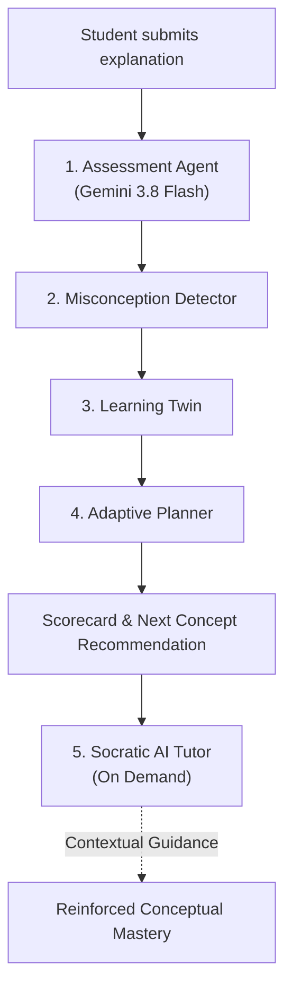
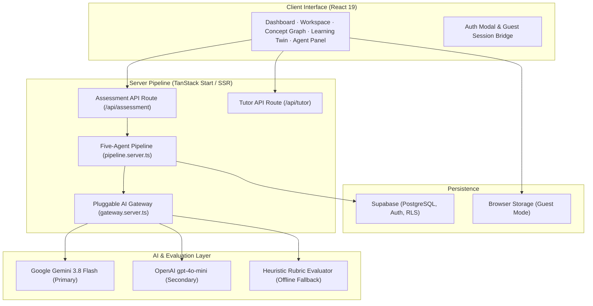

<h1 align="center">Cognify — Adaptive AI Learning Platform</h1>

<p align="center">
  <strong>An AI-powered adaptive learning platform that evaluates conceptual understanding, tracks student mastery with a Bayesian Learning Twin, and generates personalized learning paths.</strong>
</p>

<p align="center">
  Cognify replaces passive keyword quizzes with an active explanation loop. Students explain concepts in their own words, receive criterion-level AI evaluations with partial credit, identify specific misconceptions, and progress through a dynamic prerequisite knowledge graph.
</p>

---

## Table of Contents

- [Overview](#overview)
- [The Problem](#the-problem)
- [Our Solution](#our-solution)
- [Key Features](#key-features)
- [How Cognify Works](#how-cognify-works)
- [System Architecture](#system-architecture)
- [The Five Agents](#the-five-agents)
- [Learning Twin & Mastery Model](#learning-twin--mastery-model)
- [Technology Stack](#technology-stack)
- [Screenshots](#screenshots)
- [Project Structure](#project-structure)
- [Getting Started](#getting-started)
- [Environment Variables](#environment-variables)
- [Roadmap](#roadmap)
- [Acknowledgements](#acknowledgements)

---

## Overview

Most learning tools test recall by checking for exact keyword matches or multiple-choice selections. Cognify evaluates conceptual understanding: **does the student grasp the principles and runtime mechanics of a concept, and what should they study next?**

Students explain concepts in their own words. Cognify semantically evaluates their explanations against topic-specific rubrics, distinguishes factual errors from omissions, maintains an exponential moving average mastery model, and guides the student through an adaptive curriculum DAG.

The platform brings together an explanation-based assessment studio, a Bayesian Learning Twin, a topological concept graph, and an on-demand Socratic AI Tutor.

---

## The Problem

Traditional computer-based assessments suffer from common limitations:
- **Keyword matching**: Correct explanations phrased in unique ways are marked wrong, while memorized buzzwords receive full credit.
- **All-or-nothing scoring**: Partial understanding is not recognized or rewarded.
- **Conflating omission with error**: Leaving out an advanced detail is treated as a factual contradiction.
- **Static progression**: Students are forced through linear chapter lists regardless of individual mastery or prerequisite gaps.

Students need feedback that explains:
- Which specific criteria they demonstrated accurately.
- Which concepts were omitted or incompletely explained.
- Whether any explicit misconceptions were detected.
- Which prerequisite or next topic they should focus on next.

---

## Our Solution

Cognify implements an adaptive, evidence-driven learning loop:

1. **Explain** — The student articulates a concept in their own words within the interactive study workspace.
2. **Evaluate** — The Assessment Agent evaluates conceptual understanding against topic-specific rubric criteria, awarding independent partial credit.
3. **Diagnose** — The Misconception Detector separates factual errors from incomplete information and tracks recurring misconceptions.
4. **Update** — The Learning Twin updates Bayesian exponential moving average mastery and confidence based on verified assessment scores.
5. **Adapt** — The Adaptive Planner analyzes the curriculum DAG and recommends the next eligible concept.
6. **Reinforce** — The Socratic AI Tutor is available on-demand to clarify feedback and explain mechanisms without redundant evaluation calls.

---

## Key Features

| Feature | Description |
|---|---|
| **Semantic AI Assessment** | Evaluates student explanations conceptually via Gemini 3.8 Flash; checks rubric criteria independently and awards partial credit. |
| **Misconception Detection** | Distinguishes actual misconceptions from omitted points; identifies recurring misconception patterns over time. |
| **Bayesian Learning Twin** | Computes exponential moving average mastery (α = 0.55), confidence metrics, and trend indicators per concept. |
| **Adaptive Learning Planner** | Evaluates the curriculum DAG and recommends the next best learning action based on mastery and prerequisites. |
| **Curriculum Concept Graph** | Interactive topological dependency graph; nodes unlock dynamically when prerequisites reach ≥60% mastery. |
| **Socratic AI Tutor** | Context-aware tutoring agent that uses assessment evidence to clarify doubts and explain mechanics. |
| **Prerequisite Gate Enforcement** | Locked topics are strictly non-assessable across Dashboard, Concept Graph, and Workspace until prerequisites are satisfied. |
| **Multi-Agent Telemetry** | Dedicated AI Agents panel showing real-time execution times, status, and telemetry streams. |
| **Curriculum Generation** | Generates topic-specific rubrics, questions, and DAG structures for any custom subject and topic. |
| **Dual Storage (Cloud & Guest)** | Full guest mode with localStorage persistence, seamlessly upgradable to Supabase cloud authentication. |
| **Deterministic Rubric Fallback** | Safe phrase-matching rubric evaluator ensures uninterrupted assessment if the AI provider is unavailable. |

---

## How Cognify Works

Cognify coordinates five specialized learning agents in a forward-flowing cooperative pipeline:



### The Five Agents

| Agent | Source File | Responsibility |
|---|---|---|
| **Assessment Agent** | `src/lib/ai/evaluator.server.ts` | Evaluates student explanations semantically against topic rubrics; assigns criterion status (`demonstrated`, `partially_demonstrated`, `missing`, `incorrect`) and transparent scores. |
| **Misconception Detector** | `src/lib/agents/pipeline.server.ts` | Analyzes assessment evidence; isolates factual errors from incomplete knowledge; checks for recurring misconception tags across attempts. |
| **Learning Twin** | `src/lib/learning/twin.ts` | Updates Bayesian mastery estimates and confidence scores; categorizes nodes as `mastered`, `learning`, `weak`, `available`, or `locked`. |
| **Adaptive Planner** | `src/lib/learning/twin.ts` | Examines the prerequisite DAG and recommends the next concept to study; prioritizes prerequisite remediation and weak concept revision. |
| **Socratic AI Tutor** | `src/lib/agents/pipeline.server.ts` | Answers questions and explains tricky mechanisms; receives assessment evidence as context so explanations directly address demonstrated gaps. |

---

## System Architecture



---

## Learning Twin & Mastery Model

The Learning Twin models the student's cognitive grasp of each topic node over time.

### Exponential Moving Average (EMA)

Mastery updates use an exponential moving average over scored attempts, weighting recent performance:

$$EMA_n = EMA_{n-1} \times (1 - \alpha) + Score_n \times \alpha$$

$$\alpha = 0.55$$

Mastery only updates when an assessment yields a valid score (support sessions for uncertain students record an attempt without penalizing mastery).

### Confidence Calculation

Confidence increases with sample size ($n$) and decreases when score variance is high:

$$\text{evidence} = 1 - \frac{1}{1 + 0.75n}$$

$$\text{confidence} = \max\left(0.10, \min\left(0.95, \text{evidence} - \frac{\sigma}{250}\right)\right)$$

### Mastery Thresholds

| State | Threshold | Meaning |
|---|---:|---|
| **Mastered** | $\ge 75\%$ | High conceptual competence demonstrated |
| **Learning** | $40\% - 74\%$ | Actively developing understanding |
| **Weak / Needs Attention** | $< 40\%$ | Targeted practice and review recommended |
| **Prerequisite Unlock Threshold** | $\ge 60\%$ | Minimum score required on prerequisites to unlock dependent nodes |

---

## Technology Stack

| Layer | Technology |
|---|---|
| **Application Framework** | [TanStack Start](https://tanstack.com/start) (Full-stack React 19, SSR) |
| **Client Routing** | [TanStack Router](https://tanstack.com/router) (Type-safe file-based routing) |
| **UI Library** | React 19, Radix UI Primitives, Lucide Icons |
| **Styling & Design System** | Tailwind CSS v4, JetBrains Mono, Space Grotesk, Plus Jakarta Sans |
| **Primary AI Provider** | Google Gemini 3.8 Flash (Direct REST API integration) |
| **Secondary AI Provider** | OpenAI gpt-4o-mini (Fallback support) |
| **Offline Evaluation** | Topic-specific phrase-matching rubric evaluator |
| **Schema Validation** | Zod v3 (Structured AI JSON schema enforcement) |
| **Database & Auth** | Supabase (PostgreSQL, Row Level Security, Supabase Auth) |
| **Data Visualization** | Recharts (Mastery progress curves, longitudinal timeline) |
| **Build & Tooling** | Vite 8, Nitro, TypeScript 5.8 |
| **Testing** | Vitest, Testing Library |

---

## Screenshots

### Onboarding
The onboarding experience introduces Cognify and guides the learner through subject, topic, and difficulty selection.


### Dashboard
The central dashboard summarizes the active curriculum track, Bayesian mastery, recent submissions, and agent status.


### Concept Graph
Interactive topological knowledge graph illustrating prerequisite dependencies, node states, and mastery badges.


### Learning Workspace
Interactive study studio featuring challenge prompts, code insertion tools, live evaluation modal, and the Socratic AI Tutor.


### Learning Twin
Visual model of cognitive competence, confidence levels, learning trends, and the misconception registry.


### Progress & History
Comprehensive assessment ledger tracking scores, criteria breakdown, evaluator feedback, and longitudinal mastery over time.


---

## Project Structure

```text
Cognify-adaptive-learning/
├── public/
│   ├── favicon.svg          # Cognify SVG favicon (navy circle, teal ring & C glyph)
│   ├── favicon.ico          # Multi-resolution Windows DIB ICO (16x16, 32x32, 48x48)
│   ├── favicon.png          # Standard 32x32 PNG favicon
│   ├── apple-touch-icon.png # 180x180 Apple touch icon
│   └── robots.txt
├── screenshots/             # Interface screenshots
│   ├── 01-onboarding.png
│   ├── 02-dashboard.png
│   ├── 03-concept-graph.png
│   ├── 04-learning-workspace.png
│   ├── 05-learning-twin.png
│   └── 06-progress-history.png
├── src/
│   ├── components/
│   │   └── cognify/
│   │       ├── App.tsx              # Root application bootstrap & auth bridge
│   │       ├── Dashboard.tsx        # Command center, curriculum cards, header
│   │       ├── Workspace.tsx        # Assessment editor, submission dialog, tutor
│   │       ├── ConceptGraph.tsx     # SVG topological prerequisite dependency graph
│   │       ├── LearningTwin.tsx     # Cognitive model, mastery stats, misconceptions
│   │       ├── AgentPanel.tsx       # Live five-agent telemetry & execution traces
│   │       ├── AuthModal.tsx        # Supabase authentication modal
│   │       ├── Onboarding.tsx       # Subject & topic track configuration
│   │       └── Walkthrough.tsx      # Interactive guided walkthrough
│   ├── data/
│   │   └── sampleData.ts            # Foundational curriculum rubrics (C++ Pointers)
│   ├── lib/
│   │   ├── ai/
│   │   │   ├── gateway.server.ts         # Pluggable AI gateway (Gemini, OpenAI, Fallback)
│   │   │   ├── evaluator.server.ts       # Assessment Agent: semantic rubric evaluation
│   │   │   ├── assessmentRubrics.server.ts # Topic-specific assessment criteria
│   │   │   ├── assessmentPrompt.server.ts  # Rubric-aligned system prompts
│   │   │   └── responseSchema.ts         # Zod schemas for AI JSON responses
│   │   ├── agents/
│   │   │   ├── pipeline.server.ts        # Five-agent cooperative execution pipeline
│   │   │   └── agents.functions.ts       # TanStack Start server functions
│   │   ├── learning/
│   │   │   ├── twin.ts                   # Pure Bayesian twin & planner algorithms
│   │   │   ├── curriculumService.ts      # AI & heuristic curriculum generation
│   │   │   └── useLearningData.ts        # Data hook: assessments, storage sync, twin
│   │   ├── auth/
│   │   │   └── AuthContext.tsx           # Supabase authentication context
│   │   └── error-reporting.ts            # Client error boundary logger
│   ├── routes/
│   │   ├── __root.tsx       # Root document shell, favicon links, dark theme init
│   │   └── index.tsx        # Main application route
│   └── styles.css           # Global Tailwind CSS styles & typography variables
├── drizzle/                 # Database schema migrations
├── supabase/
│   └── config.toml          # Supabase project configuration
├── package.json
├── vite.config.ts           # Vite + TanStack Start configuration
└── tsconfig.json
```

---

## Getting Started

### Prerequisites

- [Node.js](https://nodejs.org/) (version 18 or higher)
- npm or bun

### 1. Clone the repository

```bash
git clone https://github.com/Thishanth-T/Cognify-adaptive-learning.git
cd Cognify-adaptive-learning
```

### 2. Install dependencies

```bash
npm install
```

### 3. Configure environment variables

Create a `.env` file in the project root:

```env
# Google Gemini API Key (Required for live AI assessment)
GEMINI_API_KEY=your_gemini_api_key_here
GEMINI_MODEL=gemini-3.8-flash

# Supabase (Optional: required for cloud authentication & cross-device persistence)
# Supports full URL or Project ID; supports both PUBLISHABLE_KEY and ANON_KEY
VITE_SUPABASE_URL=https://your-project-ref.supabase.co
# VITE_SUPABASE_PROJECT_ID=your-project-ref
VITE_SUPABASE_PUBLISHABLE_KEY=your_anon_key_here
# VITE_SUPABASE_ANON_KEY=your_anon_key_here

# OpenAI API Key (Optional: secondary fallback provider)
# OPENAI_API_KEY=your_openai_api_key_here
```

> **Note:** If `GEMINI_API_KEY` is not provided, Cognify operates in **deterministic rubric fallback mode**, evaluating answers against topic-specific rubrics. Without Supabase keys, Cognify runs in **guest mode** with full offline localStorage persistence.

### 4. Start the development server

```bash
npm run dev
```

Open [http://localhost:3000](http://localhost:3000) in your browser.

### 5. Build for production

```bash
npm run build
```

### 6. Run test suites

```bash
npm run test
```

---

## Environment Variables Reference

| Variable | Environment | Required | Description |
|---|---|---|---|
| `GEMINI_API_KEY` | Server | Recommended | Google Gemini API key used by the live Assessment and Tutor agents. |
| `GEMINI_MODEL` | Server | Optional | Gemini model name (defaults to `gemini-3.8-flash`). |
| `OPENAI_API_KEY` | Server | Optional | Secondary AI provider key if Gemini is unavailable (`gpt-4o-mini`). |
| `VITE_SUPABASE_URL` | Client (Build) | Optional | Full Supabase project URL (`https://<project-ref>.supabase.co`). |
| `VITE_SUPABASE_PROJECT_ID` | Client (Build) | Optional | Supabase project ID (automatically derives `https://<id>.supabase.co` if full URL is omitted). |
| `VITE_SUPABASE_PUBLISHABLE_KEY` | Client (Build) | Optional | Supabase public / `anon` key for browser authentication & RLS queries. |
| `VITE_SUPABASE_ANON_KEY` | Client (Build) | Optional | Alias for `VITE_SUPABASE_PUBLISHABLE_KEY`. |
| `SUPABASE_URL` | Server (SSR) | Optional | Supabase project URL for server functions and SSR. |
| `SUPABASE_PROJECT_ID` | Server (SSR) | Optional | Supabase project ID for server functions (derives URL if full URL is omitted). |
| `SUPABASE_PUBLISHABLE_KEY` | Server (SSR) | Optional | Supabase public / `anon` key for server auth middleware token validation. |
| `SUPABASE_ANON_KEY` | Server (SSR) | Optional | Alias for `SUPABASE_PUBLISHABLE_KEY` on server. |
| `SUPABASE_SERVICE_ROLE_KEY` | Server (SSR) | Optional | Service-role secret key (admin operations only; **never** exposed to client). |
| `DATABASE_URL` | Server (CI/Local) | Optional | PostgreSQL connection string for Drizzle ORM schema migrations. |
| `CRON_SECRET` | Server (SSR) | Optional | Bearer secret for authenticated scheduled task triggers. |

---

## Roadmap

- [ ] **Spaced-Repetition Scheduling** — Resurface weak or decaying concepts using the SM-2 algorithm.
- [ ] **Multi-Subject Expansion** — Specialized rubric templates for Python, Rust, algorithms, and system design.
- [ ] **Classroom Analytics Dashboard** — Aggregated cohort analytics for instructors.
- [ ] **Dynamic Coding Sandboxes** — In-browser execution environments alongside conceptual explanations.
- [ ] **Peer Explanation Review** — Collaborative review sessions with AI-guided moderation.

---

## Acknowledgements

Cognify is built with open-source software and tools:
- [TanStack Start](https://tanstack.com/start) & [TanStack Router](https://tanstack.com/router)
- [React 19](https://react.dev/)
- [Google Gemini API](https://ai.google.dev/)
- [Supabase](https://supabase.com/)
- [Tailwind CSS](https://tailwindcss.com/)
- [Radix UI](https://www.radix-ui.com/)
- [Zod](https://zod.dev/)
- [Recharts](https://recharts.org/)

---

<p align="center">
  <strong>Cognify — Adaptive AI Learning Platform</strong><br>
  <em>Understand conceptually. Master systematically. Progress adaptively.</em>
</p>
