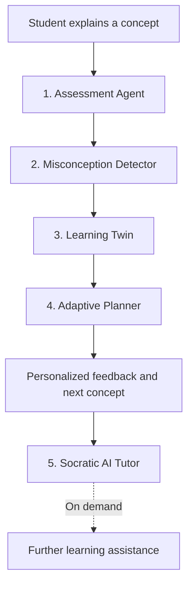
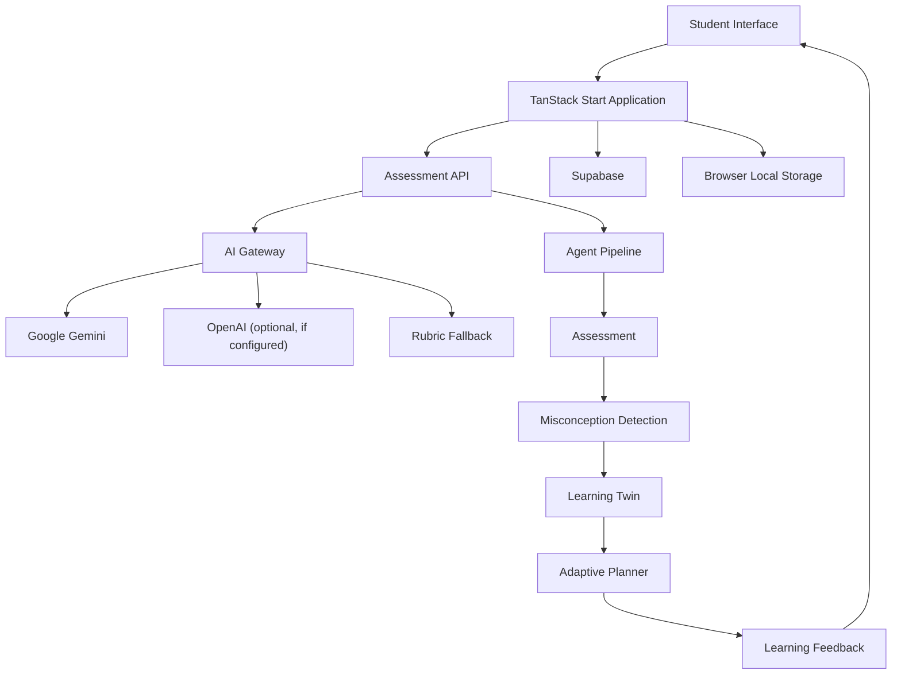
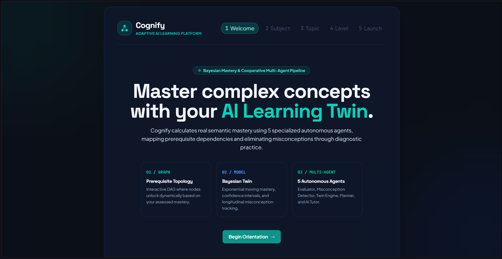
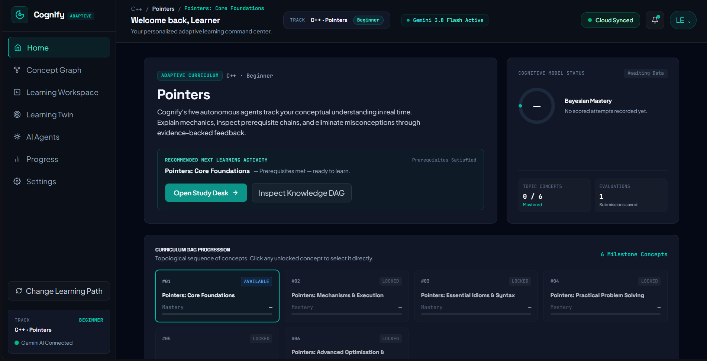
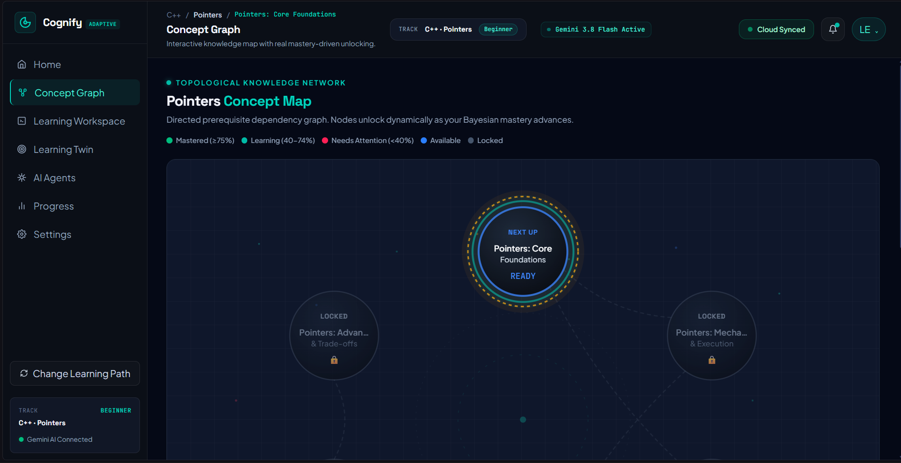
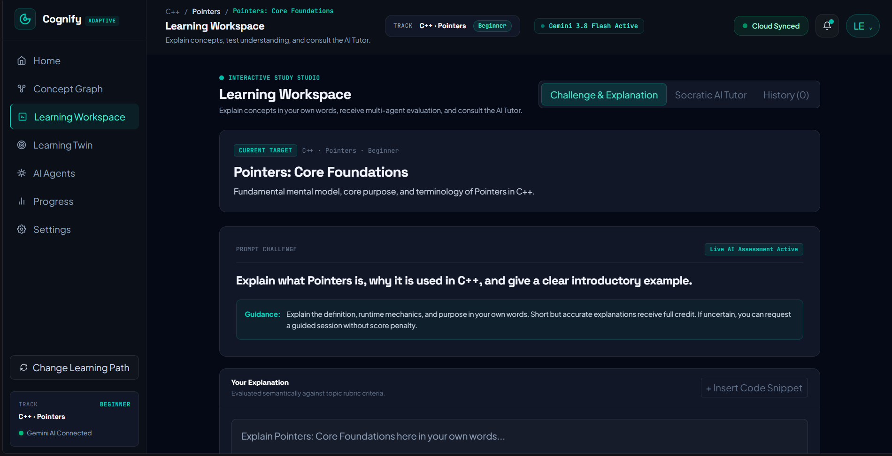
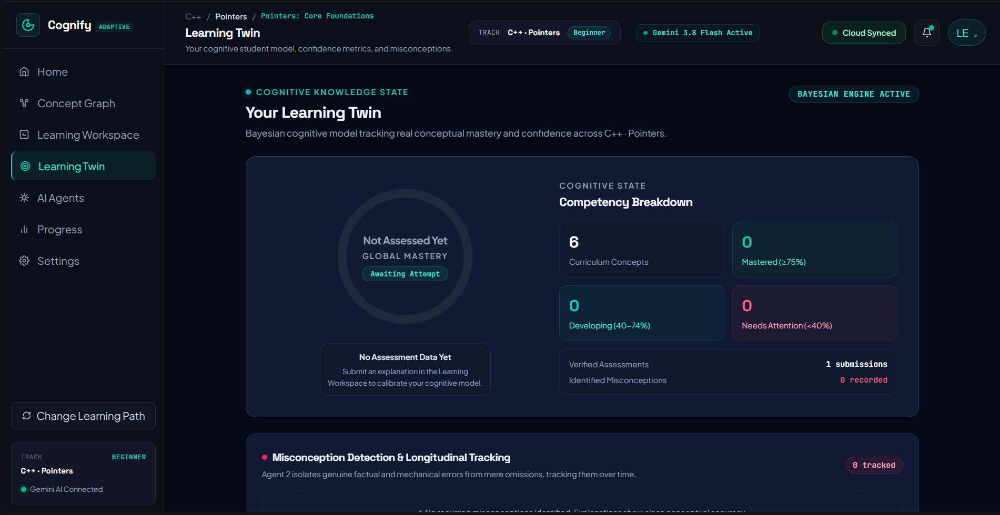
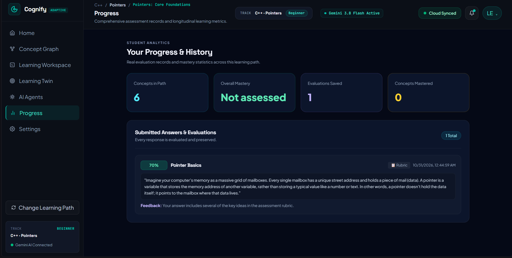

<h1 align="center">Cognify — Your Adaptive Learning Platform</h1>

<p align="center">
  <strong>An AI-powered adaptive learning platform that focuses on how students understand concepts.</strong>
</p>

<p align="center">
  Cognify turns explanation-based assessments into a personalized learning experience. Students explain concepts in their own words, receive structured feedback, identify knowledge gaps, and follow a learning path shaped by concept prerequisites and assessment evidence.
</p>

---

## Table of Contents

- [Overview](#overview)
- [The Problem](#the-problem)
- [Our Approach](#our-approach)
- [Key Features](#key-features)
- [How Cognify Works](#how-cognify-works)
- [System Architecture](#system-architecture)
- [The Five Agents](#the-five-agents)
- [Learning Twin and Mastery Model](#learning-twin-and-mastery-model)
- [Technology Stack](#technology-stack)
- [Screenshots](#screenshots)
- [Project Structure](#project-structure)
- [Getting Started](#getting-started)
- [Environment Variables](#environment-variables)
- [Roadmap](#roadmap)
- [Acknowledgements](#acknowledgements)

---

## Overview

Most learning platforms focus on whether an answer is right or wrong. Cognify focuses on a deeper question: **does the student understand the concept, and what should they learn next?**

Students explain concepts in their own words. Cognify evaluates their explanations against topic-specific criteria, surfaces potential misconceptions, tracks learning evidence, and recommends the next available concept.

The platform brings together an explanation-based assessment workflow, a Learning Twin, a prerequisite-aware curriculum graph, and an on-demand Socratic AI Tutor.

## The Problem

Traditional quizzes and keyword-based assessments can overlook partial understanding, reward memorized phrases, and provide limited guidance about what a student should revise.

Students need feedback that explains:
- Which parts of their understanding are correct.
- Which concepts may be incomplete or misunderstood.
- How their progress changes over multiple attempts.
- Which prerequisite or follow-up concept they should work on next.

## Our Approach

Cognify uses an adaptive learning loop:

1. **Explain** — The student describes a concept in their own words.
2. **Evaluate** — The assessment workflow evaluates the response against topic-specific criteria.
3. **Diagnose** — The misconception analysis identifies potential conceptual gaps.
4. **Update** — The Learning Twin updates its learning state using available assessment evidence.
5. **Adapt** — The planner recommends an eligible next concept using the curriculum prerequisites.
6. **Explore** — The student can request further help from the Socratic AI Tutor.

The aim is to make assessment useful for the next learning decision, rather than presenting a score in isolation.

---

## Key Features

| Feature | Description |
|---|---|
| Explanation-based assessment | Evaluates student explanations against topic-specific criteria. |
| Misconception analysis | Highlights potential factual errors and gaps in understanding. |
| Learning Twin | Presents a learner's mastery state and assessment evidence. |
| Adaptive learning path | Uses concept prerequisites and learning progress to guide progression. |
| Curriculum Concept Graph | Visualizes concepts and their prerequisite relationships. |
| Socratic AI Tutor | Offers additional learning assistance when requested. |
| Assessment history | Displays saved submissions and feedback. |
| Guest and account experiences | Supports the configured guest and Supabase authentication flows. |
| Rubric fallback | Provides a fallback evaluation path when the AI provider is unavailable, where configured. |

Feature availability depends on the current application configuration and connected services.

---

## How Cognify Works

Cognify organizes the learning workflow around five cooperating agents. The tutor is available on demand.



### Agent responsibilities

1. **Assessment Agent** — Evaluates the student's explanation against topic-specific assessment criteria and produces structured feedback.
2. **Misconception Detector** — Analyzes the response and assessment evidence for incorrect or incomplete understanding.
3. **Learning Twin** — Updates the learner's mastery estimates using available evidence.
4. **Adaptive Planner** — Recommends a next concept while considering prerequisite relationships.
5. **Socratic AI Tutor** — Provides additional explanations and guided assistance when the student requests it.

---

## System Architecture

The following diagram represents the intended high-level application flow. Optional providers and fallback behavior depend on the environment configuration.



The application connects its user interface to server-side assessment and learning workflows. Supabase and browser storage are used according to the configured account and guest experiences.

---

## The Five Agents

| Agent | Responsibility |
|---|---|
| Assessment Agent | Evaluates explanations against assessment criteria. |
| Misconception Detector | Identifies potential errors and conceptual gaps. |
| Learning Twin | Maintains mastery estimates and learning evidence. |
| Adaptive Planner | Recommends learning progression based on prerequisites and progress. |
| Socratic AI Tutor | Provides contextual assistance on demand. |

The workflow is designed to reuse structured assessment evidence between stages rather than treating every agent as an unrelated assessment.

---

## Learning Twin and Mastery Model

The Learning Twin represents the learner's evolving understanding across curriculum concepts.

The interface presents information such as:
- Concept mastery state.
- Assessment and submission counts.
- Concepts that are mastered, developing, or need attention.
- Identified misconceptions, when available.
- Learning progress across the selected path.

### Exponential Moving Average

The project documentation describes an Exponential Moving Average (EMA) update for mastery estimates:

\[
EMA_n = EMA_{n-1}(1-\alpha) + Score_n\alpha
\]

The documented learning-rate value is:

\[
\alpha = 0.55
\]

This gives more weight to recent assessment evidence. The actual displayed mastery state depends on the assessment data available to the application.

### Documented mastery thresholds

| State | Threshold |
|---|---:|
| Mastered | 75% and above |
| Developing | 40%–74% |
| Needs attention | Below 40% |
| Prerequisite unlock threshold | 60% |

---

## Technology Stack

The original project documentation identifies the following technologies. Confirm the current `package.json` and server configuration before changing versions or removing dependencies.

| Layer | Technology |
|---|---|
| Application framework | TanStack Start |
| Frontend | React, TypeScript |
| Routing | TanStack Router |
| Styling | Tailwind CSS |
| UI primitives | Radix UI |
| AI integration | Google Gemini; optional OpenAI integration if configured |
| AI gateway | Lovable AI Gateway integration, where used |
| Validation | Zod |
| Database and authentication | Supabase |
| Build tooling | Vite |
| Vite configuration | `@lovable.dev/vite-tanstack-config`, if still present |
| Testing | Vitest, Testing Library |
| Charts | Recharts |

---

## Screenshots

### Onboarding

The onboarding flow introduces Cognify and guides the learner through subject, topic, and difficulty selection.



### Dashboard

The dashboard summarizes the selected learning path, recommended next activity, and current cognitive-model status.



### Concept Graph

The concept graph visualizes the curriculum's prerequisite relationships and indicates which concepts are available or locked.



### Learning Workspace

The workspace is where students explain concepts in their own words and access assessment and tutoring features.



### Learning Twin

The Learning Twin presents the learner's current cognitive state, competency breakdown, and available assessment evidence.



### Progress and History

The progress page displays saved evaluations and learning-history information.



---

## Project Structure

The following is a guide to the main areas described in the project documentation. Keep it synchronized with the actual repository as files change.

```text
Cognify-adaptive-learning/
├── public/
├── src/
│   ├── components/
│   │   └── cognify/
│   │       ├── App.tsx
│   │       ├── Dashboard.tsx
│   │       ├── Workspace.tsx
│   │       ├── ConceptGraph.tsx
│   │       ├── LearningTwin.tsx
│   │       ├── AgentPanel.tsx
│   │       ├── AuthModal.tsx
│   │       └── Onboarding.tsx
│   ├── lib/
│   │   ├── ai/
│   │   ├── agents/
│   │   ├── learning/
│   │   └── auth/
│   ├── routes/
│   └── styles.css
├── supabase/
├── package.json
├── vite.config.ts
└── tsconfig.json
```

---

## Getting Started

### Prerequisites

- Node.js version supported by the project's `package.json`.
- npm.
- A configured Supabase project and/or AI provider for features that depend on those services.

### 1. Clone the repository

```bash
git clone https://github.com/Thishanth-T/Cognify-adaptive-learning.git
```

### 2. Enter the project directory

```bash
cd Cognify-adaptive-learning
```

### 3. Install dependencies

```bash
npm install
```

### 4. Configure environment variables

Create a `.env` file in the project root. Use the variable names required by the current server and Supabase configuration.

### 5. Start the development server

```bash
npm run dev
```

Open the local URL printed in the terminal.

### Production build

```bash
npm run build
```

Run tests using the test script defined in `package.json` (for example, `npm test` if that script exists).

---

## Environment Variables

The exact variable names must match the implementation in the repository. The following are examples of common configuration entries; do not add variables that the code does not read.

```env
# Supabase — use the exact names expected by your application
VITE_SUPABASE_URL=your_supabase_project_url
VITE_SUPABASE_ANON_KEY=your_supabase_anon_key

# Gemini — use the exact server-side variable name expected by the AI gateway
GEMINI_API_KEY=your_gemini_api_key

# Optional OpenAI integration, only if implemented and enabled
OPENAI_API_KEY=your_openai_api_key
```

**Security**
- Never commit the real `.env` file or API keys.
- Keep private AI provider keys on the server.
- Do not expose secret keys in browser-side code.
- Provide an `.env.example` containing placeholders if the project uses one.

If no AI provider is configured, the application may use its rubric fallback if that fallback is enabled. Cloud authentication and persistence require the corresponding Supabase configuration.

---

## Roadmap

Potential future improvements include:

- Spaced-repetition scheduling.
- Expanded multilingual learning support.
- Instructor dashboards and class-level analytics.
- Additional adaptive practice activities.
- Collaborative learning features.
- Offline learning support.

---

## Acknowledgements

Cognify uses open-source technologies and external services, including React, TanStack, Supabase, Tailwind CSS, Radix UI, Zod, and Recharts.

### Development tools

The project was developed with assistance from **Lovable** and **Google Antigravity**. Lovable-related gateway or build-configuration packages are retained in the technology description where they remain part of the codebase.

Cognify is an independent project and is not affiliated with or endorsed by the third-party services it integrates with.

---

<p align="center">
  <strong>Cognify — Your Adaptive Learning Platform</strong><br>
  <em>Understand more. Learn better. Progress smarter.</em>
</p>
