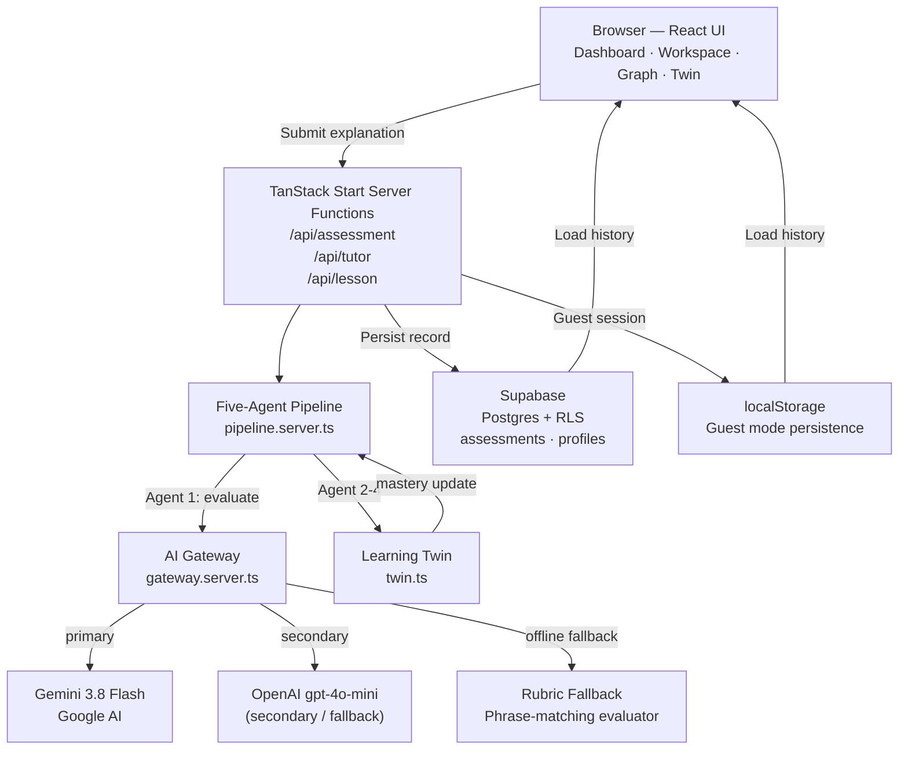

# Cognify — Adaptive AI Learning Platform

> An AI-powered learning system that evaluates conceptual understanding, tracks mastery with a Bayesian model, detects misconceptions, and generates personalized learning plans through a five-agent cooperative pipeline.

---

## Table of Contents

- [Problem Statement](#problem-statement)
- [Solution](#solution)
- [Key Features](#key-features)
- [How Cognify Works](#how-cognify-works)
- [System Architecture](#system-architecture)
- [The Five Agents](#the-five-agents)
- [Technology Stack](#technology-stack)
- [Project Structure](#project-structure)
- [Local Setup](#local-setup)
- [Environment Variables](#environment-variables)
- [Screenshots](#screenshots)
- [Roadmap](#roadmap)
- [Acknowledgements](#acknowledgements)

---

## Problem Statement

Traditional learning tools assess students through keyword-matching quizzes or static multiple-choice tests. They score answers mechanically, ignore partial understanding, fail to identify where the student's mental model breaks down, and produce no actionable path forward.

The result: students pass tests without truly understanding a concept, and are given no feedback about which specific ideas they are missing or misrepresenting.

---

## Solution

Cognify replaces passive quizzes with an active explanation loop:

1. The student explains a concept in their own words.
2. A live AI model (Gemini 3.8 Flash) semantically evaluates the explanation against topic-specific rubric criteria, awarding partial credit independently per criterion.
3. A Misconception Detector distinguishes incorrect statements from incomplete knowledge.
4. A Bayesian Learning Twin updates the student's mastery model based on verified evidence.
5. An Adaptive Planner generates the next recommended concept based on the updated twin state.
6. A Socratic AI Tutor is available on-demand to explain gaps without repeating the evaluation.

Short but accurate answers receive appropriate credit. Vague or incorrect explanations are caught with criterion-level evidence. The student always knows exactly what they demonstrated, what was missing, and what to study next.

---

## Key Features

| Feature | Status | Description |
|---|---|---|
| AI-powered semantic assessment | ✅ Implemented | Gemini 3.8 Flash evaluates explanations per rubric criterion with partial credit |
| Misconception detection | ✅ Implemented | Separates factual errors from incomplete knowledge; tracks recurring patterns |
| Bayesian Learning Twin | ✅ Implemented | Exponential moving average mastery, confidence metric, and trend tracking per concept |
| Adaptive Learning Planner | ✅ Implemented | Prerequisite-aware next-concept recommendation from the updated twin state |
| Socratic AI Tutor | ✅ Implemented | On-demand tutor reuses assessment evidence; no redundant evaluation calls |
| Curriculum Concept Graph | ✅ Implemented | AI-generated or heuristic DAG; nodes unlock when prerequisites reach ≥60% mastery |
| Dynamic curriculum generation | ✅ Implemented | AI generates topic-specific rubrics, questions, and DAG for any subject/topic |
| Rubric fallback | ✅ Implemented | Phrase-matching rubric evaluator activates when AI is unavailable |
| Supabase cloud persistence | ✅ Implemented | Assessment records, profiles, mastery history via Supabase with RLS |
| Guest mode | ✅ Implemented | Full offline practice with localStorage persistence; upgrades to cloud on sign-in |
| Authentication | ✅ Implemented | Email/password and Google OAuth via Supabase Auth |
| Assessment history | ✅ Implemented | Per-concept attempt timeline with score, evidence, and feedback |
| Prerequisite gate enforcement | ✅ Implemented | Locked topics are blocked across Dashboard, Graph, and Workspace |
| Agent telemetry dashboard | ✅ Implemented | Live per-agent execution times, status, and trace stream |
| Multi-subject support | ✅ Implemented | Any subject/topic pair triggers AI curriculum generation |
| Mobile-responsive UI | ✅ Implemented | Fully responsive dark/light theme |

---

## How Cognify Works

```
Student submits explanation
         │
         ▼
┌─────────────────────────────────────────────────┐
│  Agent 1 — Assessment Agent                     │
│  Gemini 3.8 Flash evaluates the explanation      │
│  against topic-specific rubric criteria.         │
│  Each criterion is scored independently.         │
│  Partial credit is awarded per criterion.        │
│  Output: score, strengths, missing, misconceptions│
└────────────────────┬────────────────────────────┘
                     │
                     ▼
┌─────────────────────────────────────────────────┐
│  Agent 2 — Misconception Detector               │
│  Receives assessment output only.               │
│  Separates factual errors from omissions.       │
│  Identifies recurring misconception patterns.   │
└────────────────────┬────────────────────────────┘
                     │
                     ▼
┌─────────────────────────────────────────────────┐
│  Agent 3 — Learning Twin                        │
│  Updates concept mastery via EMA (α=0.55)       │
│  only when a real score is present.             │
│  Computes confidence and trend.                 │
│  Determines concept state: mastered/learning/   │
│  weak/available/locked.                         │
└────────────────────┬────────────────────────────┘
                     │
                     ▼
┌─────────────────────────────────────────────────┐
│  Agent 4 — Adaptive Planner                     │
│  Reads updated twin state.                      │
│  Selects next concept respecting prerequisites. │
│  Adjusts recommendation if gaps/recurring       │
│  misconceptions detected.                       │
└────────────────────┬────────────────────────────┘
                     │
                     ▼
         Evaluation result displayed
         (score, criteria, strengths,
          missing, misconceptions,
          next concept recommendation)
                     │
                     ▼ (on demand)
┌─────────────────────────────────────────────────┐
│  Agent 5 — Socratic AI Tutor                    │
│  Called on-demand for questions about the       │
│  concept or the assessment feedback.            │
│  Receives assessment evidence as context;       │
│  no redundant evaluation call is made.          │
└─────────────────────────────────────────────────┘
```

### Mastery Thresholds

| Threshold | Value | Meaning |
|---|---|---|
| `MASTERED_AT` | 75% | Concept is considered mastered |
| `UNLOCK_AT` | 60% | Prerequisite threshold to unlock dependent topics |
| `WEAK_BELOW` | 40% | Concept marked weak; targeted review recommended |

### Mastery Formula

Cognify uses an **Exponential Moving Average** (EMA) over scored attempts, biased toward recent performance (α = 0.55):

```
EMA₁ = score₁
EMAₙ = EMAₙ₋₁ × 0.45 + scoreₙ × 0.55
```

Confidence grows with number of scored attempts and decreases with high score variance:

```
confidence = evidence − (std_dev / 250)
evidence   = 1 − 1 / (1 + n × 0.75)
```

---

## System Architecture



---

## The Five Agents

| Agent | File | Trigger | Responsibility |
|---|---|---|---|
| **Assessment Agent** | `evaluator.server.ts` | Every submission | Semantic evaluation against topic rubric; independent per-criterion scoring; partial credit |
| **Misconception Detector** | `pipeline.server.ts` | After Assessment | Separates factual errors from incomplete knowledge; identifies recurring patterns |
| **Learning Twin** | `twin.ts` | After Misconception | Updates EMA mastery and confidence; determines concept state; builds timeline |
| **Adaptive Planner** | `twin.ts → planLearning()` | After Twin | Selects next concept; respects prerequisite DAG; adjusts for recurring gaps |
| **Socratic AI Tutor** | `pipeline.server.ts → tutorAnswer()` | On demand | Answers student questions using assessment evidence as context |

Agents operate in a strict forward-only data pipeline: each agent receives only the structured output of its predecessors. The Assessment Agent's evaluation is authoritative; no subsequent agent re-evaluates the student's answer.

---

## Technology Stack

| Layer | Technology |
|---|---|
| **Framework** | [TanStack Start](https://tanstack.com/start) (React 19, SSR, server functions) |
| **Router** | [TanStack Router](https://tanstack.com/router) (file-based, type-safe) |
| **UI** | React 19, Tailwind CSS v4, Radix UI primitives |
| **Typography** | Plus Jakarta Sans, Space Grotesk, JetBrains Mono (Google Fonts) |
| **AI Provider** | Google Gemini 3.8 Flash (primary), OpenAI gpt-4o-mini (secondary), phrase-matching rubric (offline fallback) |
| **AI Gateway** | `@lovable.dev/ai-gateway` + direct Gemini/OpenAI API calls |
| **Schema Validation** | [Zod](https://zod.dev) (AI response validation, schema enforcement) |
| **Database** | [Supabase](https://supabase.com) (Postgres + Row Level Security) |
| **Authentication** | Supabase Auth (email/password + Google OAuth) |
| **Build Tool** | Vite 8 + `@lovable.dev/vite-tanstack-config` |
| **Testing** | Vitest + Testing Library |
| **Linting** | ESLint 9 + typescript-eslint + Prettier |
| **Charts** | Recharts (mastery timeline, progress views) |

---

## Project Structure

```
project-migration-studio/
├── public/
│   ├── favicon.ico          # Cognify branded ICO (32×32)
│   ├── favicon.svg          # Cognify branded SVG favicon
│   └── robots.txt
├── src/
│   ├── components/
│   │   └── cognify/
│   │       ├── App.tsx              # Root app + auth/session bootstrap
│   │       ├── Dashboard.tsx        # Main dashboard, navigation, curriculum cards
│   │       ├── Workspace.tsx        # Assessment editor, submission modal, AI Tutor tab
│   │       ├── ConceptGraph.tsx     # SVG prerequisite dependency graph
│   │       ├── LearningTwin.tsx     # Mastery visualization, misconception report
│   │       ├── AgentPanel.tsx       # Live agent telemetry dashboard
│   │       ├── AuthModal.tsx        # Sign-in / sign-up modal
│   │       ├── Onboarding.tsx       # Subject/topic/level selection
│   │       └── Walkthrough.tsx      # First-run guided tour
│   ├── data/
│   │   └── sampleData.ts           # Pre-defined C++ Pointers curriculum (fallback)
│   ├── lib/
│   │   ├── ai/
│   │   │   ├── gateway.server.ts         # Pluggable AI gateway (Gemini, OpenAI, fallback)
│   │   │   ├── evaluator.server.ts       # Assessment Agent: AI + rubric evaluation
│   │   │   ├── assessmentRubrics.server.ts # Topic-specific rubric definitions
│   │   │   ├── assessmentPrompt.server.ts  # Assessment prompt construction
│   │   │   └── responseSchema.ts         # Zod schemas for AI JSON responses
│   │   ├── agents/
│   │   │   ├── pipeline.server.ts        # Five-agent cooperative pipeline
│   │   │   └── agents.functions.ts       # TanStack Start server function wrappers
│   │   ├── learning/
│   │   │   ├── twin.ts                   # Learning Twin + Planner (pure, shared)
│   │   │   ├── curriculumService.ts      # AI curriculum generation + heuristic fallback
│   │   │   └── useLearningData.ts        # React hook: data loading, submission, Supabase sync
│   │   └── auth/
│   │       └── AuthContext.tsx           # Auth context, Supabase session management
│   ├── routes/
│   │   ├── __root.tsx       # Document shell, meta, favicon, theme script
│   │   └── index.tsx        # Main route
│   └── styles.css           # Global styles, design tokens, Tailwind config
├── drizzle/                 # DB schema (auto-generated placeholder)
├── supabase/
│   └── config.toml
├── package.json
├── vite.config.ts
└── tsconfig.json
```

---

## Local Setup

### Prerequisites

- Node.js ≥ 18
- npm or bun

### Install and Run

```sh
git clone <repository-url>
cd project-migration-studio
npm install
npm run dev
```

The application starts on `http://localhost:3000` by default.

### Build

```sh
npm run build
```

### Test

```sh
npm test
```

---

## Environment Variables

Create a `.env` file at the project root. **Never commit real credentials.**

```env
# Supabase — required for cloud persistence and authentication
VITE_SUPABASE_URL=https://your-project.supabase.co
VITE_SUPABASE_ANON_KEY=your_supabase_anon_key

# Google Gemini — required for live AI assessment (primary provider)
GEMINI_API_KEY=your_gemini_api_key

# Optional: Gemini model override (defaults to gemini-3.8-flash)
GEMINI_MODEL=gemini-3.8-flash

# Optional: OpenAI key — used as secondary provider if Gemini is unavailable
OPENAI_API_KEY=your_openai_api_key
```

> Without `GEMINI_API_KEY`, Cognify automatically falls back to the rubric-based phrase-matching evaluator. The app is fully functional in offline fallback mode; only the AI semantic evaluation is unavailable.

> Without Supabase keys, the app runs in **guest mode** with localStorage persistence only.

---

## Screenshots

> Screenshots will be added after the first production deployment.

| View | Description |
|---|---|
| Dashboard | Curriculum DAG progression cards, Learning Twin overview, agent status |
| Learning Workspace | Assessment prompt, answer editor, evaluation modal, AI Tutor tab |
| Concept Graph | SVG topological graph with prerequisite-aware state coloring |
| Learning Twin | Mastery per concept, confidence, trend, misconception registry |
| AI Agents Panel | Live telemetry: per-agent execution times, status, trace stream |
| Results Modal | Score, rubric criteria breakdown, strengths, missing concepts, misconceptions |

---

## Roadmap

Items below are planned and not yet implemented.

- [ ] **Spaced repetition scheduler** — resurface weak concepts at optimal intervals using SM-2 or similar
- [ ] **Multi-language curriculum support** — subjects beyond programming (mathematics, sciences, language learning)
- [ ] **Instructor dashboard** — class-wide mastery analytics and misconception aggregation
- [ ] **LLM-generated practice challenges** — dynamic coding challenges generated per concept and mastery level
- [ ] **Collaborative learning** — peer explanation review with AI moderation
- [ ] **Offline PWA support** — full offline capability with service worker caching
- [ ] **Accessibility audit** — WCAG 2.1 AA compliance verification and remediation

---

## Acknowledgements

- [Google Gemini API](https://ai.google.dev) — AI semantic assessment via Gemini 3.8 Flash
- [Supabase](https://supabase.com) — Postgres database, authentication, and row-level security
- [TanStack](https://tanstack.com) — TanStack Start (SSR framework) and TanStack Router
- [Radix UI](https://radix-ui.com) — Accessible UI primitives
- [Tailwind CSS](https://tailwindcss.com) — Utility-first styling
- [Zod](https://zod.dev) — Runtime schema validation for AI response enforcement
- [Recharts](https://recharts.org) — Mastery timeline and progress charts
- Built using the [Lovable](https://lovable.dev) development platform

---

*Cognify is an independent open-source project. It is not affiliated with or endorsed by Google, Supabase, or any third-party services it integrates with.*
